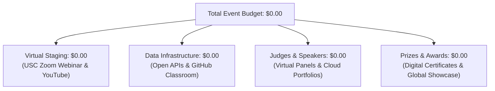

# Zero-Budget Operational Framework & Virtual Infrastructure Plan

This document details the financial structure and digital infrastructure strategy for the **2027 USC Marshall Basketball Analytics Competition (Virtual Edition)**, highlighting the **Zero-Budget ($0.00)** operating model for the MSBA program and USC Marshall.

---

## 💵 1. Zero-Budget Virtual Delivery Model
By transitioning to a fully virtual broadcast on **Zoom Webinar and YouTube Live**, all traditional physical event costs (venue rental, AV staging, physical catering, judge travel/lodging, and printed banners) are eliminated ($0.00 total expense). Furthermore, there is **no cash prize pool**; participants compete for national championship recognition, official MSBA Certificates of Distinction, direct exposure to NBA front-office leadership, and global showcase visibility.

---

## 📊 2. Itemized Operational Cost Breakdown

| Operational Category | Traditional Model Cost | Virtual Zero-Budget Strategy | Cost to USC |
| :--- | :---: | :--- | :---: |
| **Venue & Lecture Halls** | $1,500.00 | Hosted 100% online via USC Zoom Webinar license | **$0.00** |
| **AV Technicians & Staging** | $800.00 | USC Student Broadcast Leads & Zoom RTMP integration | **$0.00** |
| **Catering (Breakfast & Lunch)**| $3,500.00 | Virtual event format (participants attend remotely) | **$0.00** |
| **Judge Flights & Hotel Lodging**| $2,500.00 | Remote executive judging panel via Zoom | **$0.00** |
| **Physical Printing & Banners** | $700.00 | Digital PDF judge packets & cloud repositories | **$0.00** |
| **Prizes & Cash Awards** | $9,000.00 | Non-monetary prestige, Digital Distinction Awards, & NBA network | **$0.00** |
| **Presenter & Speaker Gifts** | $450.00 | Official digital honors, LinkedIn spotlights, & recognition | **$0.00** |
| **TOTAL EXPENSES** | **$18,450.00** | **100% Cloud-Enabled Zero-Budget Delivery** | **$0.00** |

---

## 📺 3. Digital Broadcast & Platform Specifications (Feb 20, 2027)

### A. Zoom Webinar Configuration
* **Audience:** Presenting finalist teams (top 3–5), NBA executive judges, faculty moderators, and MSBA program directors.
* **Features:** Dedicated speaker spotlights, private judge breakout room for scoring deliberations, and automated cloud recording.

### B. YouTube Live Stream Integration
* **Stream Timing:** **Saturday, February 20, 2027 (9:00 AM – 11:00 AM EST / 6:00 AM – 8:00 AM PST)**.
* **Audience:** Global public stream for graduate students, faculty mentors, sports analytics clubs, and NBA scouts.
* **Archival:** The full recording is published on the official USC Marshall YouTube channel for permanent portfolio reference for all finalist teams.

---

## 💡 4. Efficiency & Cloud Asset Utilization
1. **GitHub Classroom:** Automated repository provisioning, template distribution, and continuous integration checks for model reproducibility at $0 cost.
2. **Open-Source Data Feeds:** Curated play-by-play datasets sourced via open data pipelines (NBA API, Sportradar public developer sets, Kaggle open tracking sets).
3. **Digital Scorecards:** Faculty and NBA judge evaluations managed via Qualtrics / Google Forms with real-time scoring aggregation.
