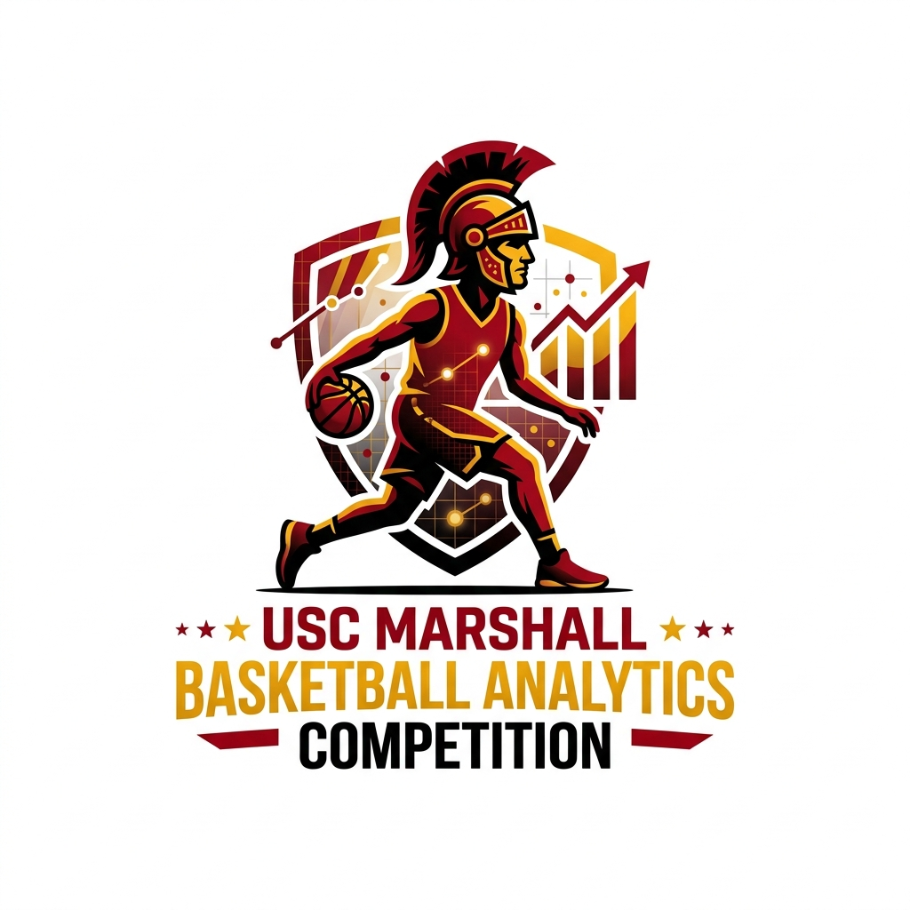
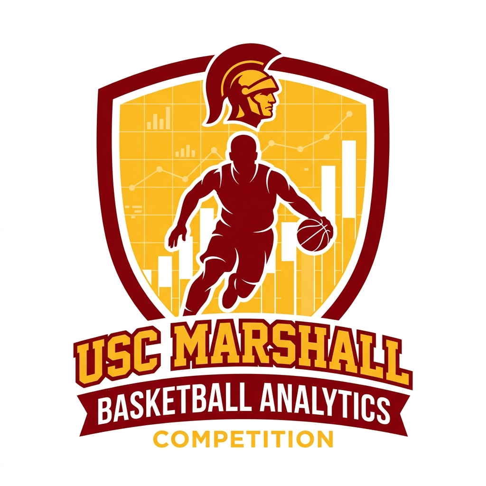
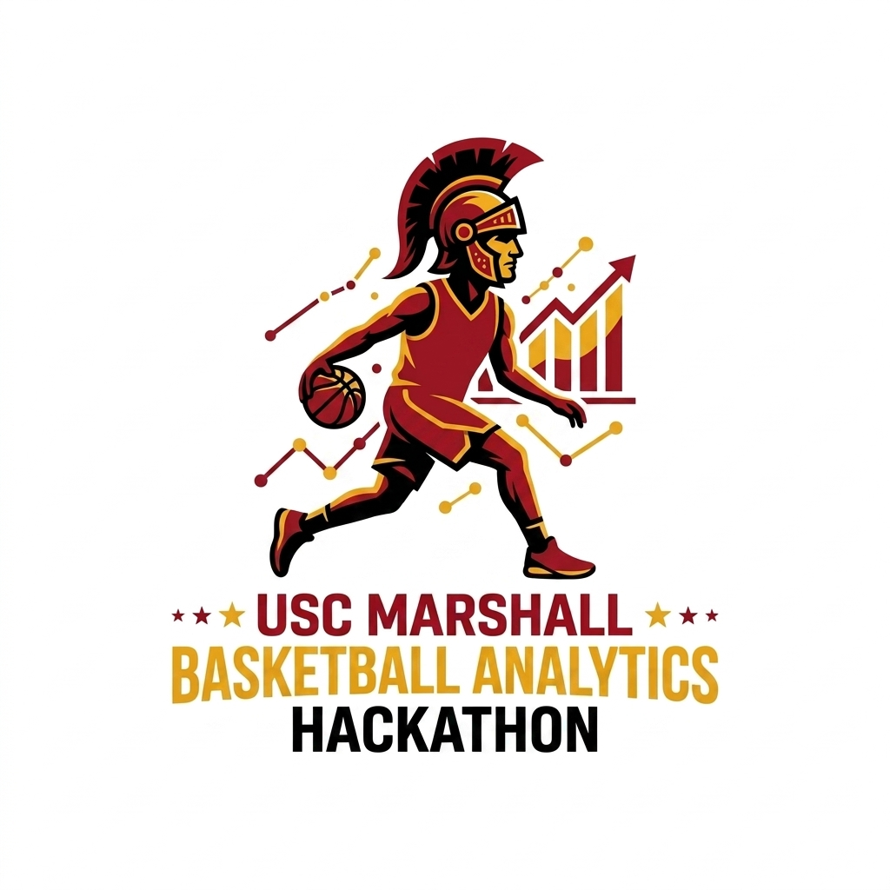
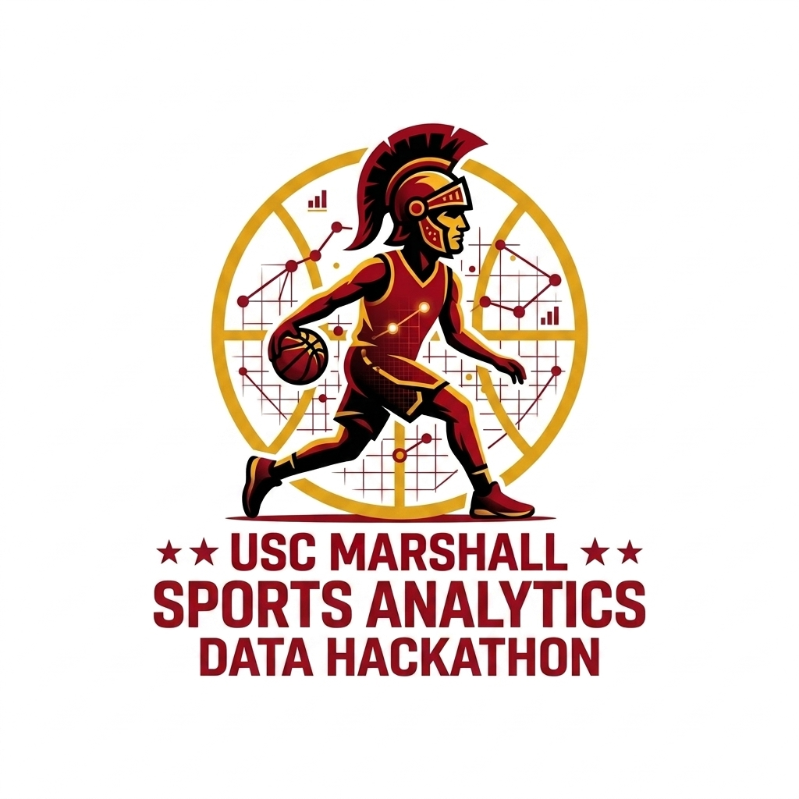
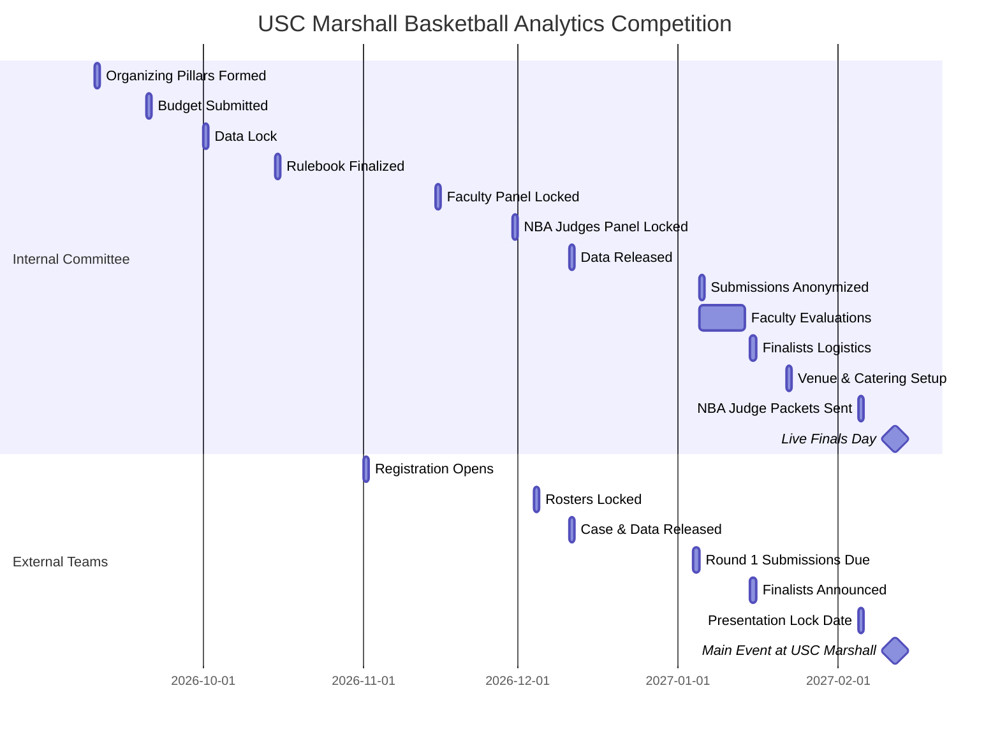

# USC Marshall - Sports Analytics Data Hackathon 🏀

We have created four premium brand logo variants for the hackathon. You can compare them below:

| Logo Variant 1: Sideways Drive (With Shield) | Logo Variant 2: Front-Facing Drive (With Shield) |
| :---: | :---: |
|  |  |
| *Jerry West style with background analytics shield.* | *Front-facing drive pose with data charts.* |

| Logo Variant 3: Sideways Drive (Shield-Free - Floating Graphs) | Logo Variant 4: Sideways Drive (Shield-Free - Circular Grid) |
| :---: | :---: |
|  |  |
| *Clean silhouette with floating analytics nodes.* | *Profile silhouette with circular basketball stats wireframe.* |

Welcome to the official administration and planning workspace for the **USC Marshall Sports Analytics Data Hackathon**. This workspace contains the documents, guidelines, timelines, and assets needed to plan, execute, and participate in this elite event.

---

## 📂 Directory Map & File Structure
You can navigate the documentation using the clickable links below:

* **[README.md](file:///Users/milanmiric/Documents/Admin%20Work%20Documents/MSBA%20-%20Baseketball%20Case%20Competition/README.md):** Workspace index, sitemap, and master timeline visual.

### 🌐 Public Documents (Candidate-Facing)
* **[spirit_and_timeline.md](file:///Users/milanmiric/Documents/Admin%20Work%20Documents/MSBA%20-%20Baseketball%20Case%20Competition/public_documents/spirit_and_timeline.md):** 2027 Inaugural Basketball Analytics Conference overview, external timelines, and applicant due dates.
* **[competition_rulebook.md](file:///Users/milanmiric/Documents/Admin%20Work%20Documents/MSBA%20-%20Baseketball%20Case%20Competition/public_documents/competition_rulebook.md):** Participant eligibility rules, team structure caps, slide constraints, and GitHub repository reproducibility specifications.
* **[case_prompt.md](file:///Users/milanmiric/Documents/Admin%20Work%20Documents/MSBA%20-%20Baseketball%20Case%20Competition/public_documents/case_prompt.md):** The official competition analytics task: "When are Star Basketball Players Most Effective?" (Part A: teammate synergy, Part B: team-level impact) including data sourcing guidelines and the 100-point faculty evaluation rubric.

### 🔒 Internal Documents (Committee-Only)
* **[committee_structure_and_timeline.md](file:///Users/milanmiric/Documents/Admin%20Work%20Documents/MSBA%20-%20Baseketball%20Case%20Competition/internal_documents/committee_structure_and_timeline.md):** Committee timeline responsibilities, Round 2 evaluation rubrics, anonymization checklists, and roster roles for the Executive Committee and the Local Event Planning Team.
* **[data_scoping_and_pipeline.md](file:///Users/milanmiric/Documents/Admin%20Work%20Documents/MSBA%20-%20Baseketball%20Case%20Competition/internal_documents/data_scoping_and_pipeline.md):** Data acquisition partnerships (NBA API, Sportradar, spatial tracking sample sets) and pipeline security locking timelines.
* **[operations_and_logistics.md](file:///Users/milanmiric/Documents/Admin%20Work%20Documents/MSBA%20-%20Baseketball%20Case%20Competition/internal_documents/operations_and_logistics.md):** Logistics handbook containing Fertitta and Popovich hall layouts, AV/streaming setups, catering sheets, judge binder checklists, and the official budget.
* **[outreach_and_communications.md](file:///Users/milanmiric/Documents/Admin%20Work%20Documents/MSBA%20-%20Baseketball%20Case%20Competition/internal_documents/outreach_and_communications.md):** Target academic programs marketing lists, school invitation templates, and judge recruitment outreach scripts.

---

## 📅 Roadmap & Candidate Due Dates

The vertical roadmap below highlights candidate-facing phases, milestones, and active deadlines (marked with **🚨 DUE**).

```text
📌 ROADMAP & DEADLINE TRACKING
========================================================================

  [ Nov 1, 2026 ] ──────────► Registration Portal Opens
                              └─ School invitations sent to target institutions
                                   │
                                   ▼
  [ Dec 4, 2026 ] ──────────► 🚨 Roster Registration Deadline (DUE)
                              └─ Roster lock (4-5 students, max 2 teams/school)
                                   │
                                   ▼
  [ Dec 11, 2026 ] ─────────► Case Prompt & Datasets Released 🚀
                              └─ Virtual "Tip-Off Event" livestream
                                   │
                                   ▼
  [ Jan 4, 2027 ] ──────────► 🚨 Round 1 Submissions Due (DUE)
                              └─ Maximum 15-slide PDF deck & GitHub repo link
                                   │
                                   ▼
  [ Jan 15, 2027 ] ─────────► Finalists Selection Announced
                              └─ Top 3 to 5 teams invited to live round at USC
                                   │
                                   ▼
  [ Feb 5, 2027 ] ──────────► 🚨 Final Presentation Deck Lock (DUE)
                              └─ Finalist slides locked; no further edits
                                   │
                                   ▼
  [ Feb 12, 2027 ] ─────────► 🏆 The Main Event (USC Marshall)
                              └─ Live final presentations & NBA executive Q&A
========================================================================
```

---

## 📅 Chronological Dual Timeline

### Comparison Timeline View
This table displays the concurrent timelines between the internal organizing pillars and the external team milestones leading up to the main event.

| Date | Internal Committee & Data Timeline | External Competitor Milestones | Status |
| :--- | :--- | :--- | :--- |
| **Sep 10, 2026** | Form Core Organizing Pillars (Analytics, Outreach, Operations) | *Pre-registration phase* | Completed |
| **Sep 20, 2026** | Budget finalized and submitted to Marshall Dean | *Pre-registration phase* | Completed |
| **Oct 1, 2026** | **Data Asset Lock** (clean pipelines, secure feeds) | *Pre-registration phase* | Locked |
| **Oct 15, 2026** | Rulebook and landing page asset locked | *Pre-registration phase* | Completed |
| **Nov 1, 2026** | Launch registration portal | **Registration Portal Opens** / School invitations sent | Active |
| **Nov 15, 2026** | Preliminary Faculty Judging Panel locked | Team recruitment | Planned |
| **Nov 30, 2026** | NBA Finals Judging Panel locked (3–5 professionals) | Team recruitment | Planned |
| **Dec 4, 2026** | *Roster audits and validation* | **Registration Deadline / Roster Lock** | 🚨 **DUE** |
| **Dec 11, 2026** | **Data Released Externally** & Virtual Tip-Off webinar | **Case Prompt & Data Launch** | Released |
| **Jan 4, 2027** | *Submission portals prepared* | **Round 1 Submissions Due** (Slides & GitHub) | 🚨 **DUE** |
| **Jan 5, 2027** | Sort and anonymize slides & repositories | *Preliminary review starts* | Processing |
| **Jan 5–14, 2027**| **Faculty Evaluation Window** | *Preliminary review* | In Review |
| **Jan 15, 2027** | Coordinate logistics with finalists | **Finalists Announcement** (3-5 teams) | Announced |
| **Jan 22, 2027** | Venue (Fertitta Hall), catering, and technical checks | Travel arrangements & deck polishing | In Progress |
| **Feb 5, 2027** | **NBA Judge Packets Sent** (decks, briefs, scoring booklets) | **Final Presentation Deck Lock** | 🚨 **DUE** |
| **Feb 12, 2027** | **Event Day Execution** (Popovich & Fertitta Halls) | **The Main Event (Live Q&A with NBA Executives)** | **EVENT DAY** |

---

### Visual Timeline (Gantt Chart)

