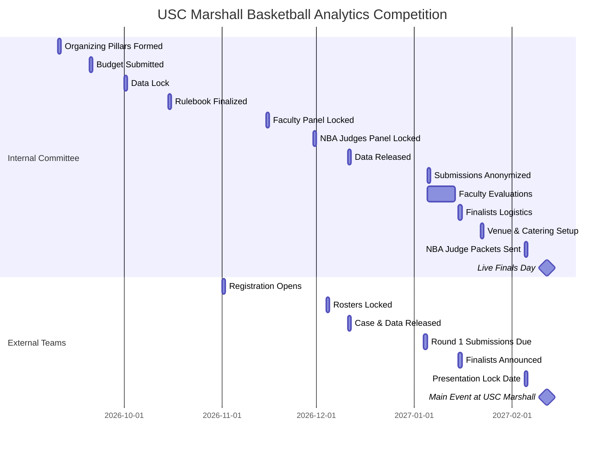

# USC Marshall Basketball Analytics Competition 🏀

We have created two premium brand logos for the competition. You can compare the original sideways silhouette (Version 1) with the new front-facing drive design (Version 2) below:

| Logo Version 1: Sideways Drive (Jerry West Style) | Logo Version 2: Front-Facing Drive |
| :---: | :---: |
|  |  |
| *Classic profile pose with grid analytics shield.* | *Dynamic front-facing drive pose with data charts.* |

Welcome to the official administration and planning workspace for the **USC Marshall Basketball Analytics Competition**. This workspace contains the documents, guidelines, timelines, and assets needed to plan, execute, and participate in this elite event.

---

## 📂 Directory Map & File Structure
You can navigate the documentation using the clickable links below:

* **[README.md](file:///Users/milanmiric/Documents/Admin%20Work%20Documents/MSBA%20-%20Baseketball%20Case%20Competition/README.md):** Workspace index, sitemap, and master timeline visual.
* **[01_spirit_and_timeline.md](file:///Users/milanmiric/Documents/Admin%20Work%20Documents/MSBA%20-%20Baseketball%20Case%20Competition/docs/01_spirit_and_timeline.md):** 2027 Inaugural Basketball Analytics Conference overview including the first logo, dual timelines, and committee roles of responsibility.
* **[02_competition_rulebook.md](file:///Users/milanmiric/Documents/Admin%20Work%20Documents/MSBA%20-%20Baseketball%20Case%20Competition/docs/02_competition_rulebook.md):** Rules governing eligibility, team structure limits, slide limits, code repository standards, and submission deadlines.
* **[03_data_scoping_and_case.md](file:///Users/milanmiric/Documents/Admin%20Work%20Documents/MSBA%20-%20Baseketball%20Case%20Competition/docs/03_data_scoping_and_case.md):** Sourcing pipelines, security locks, and a benchmark case study on star player effectiveness (synergy and team-level impact).
* **[04_evaluation_rubrics.md](file:///Users/milanmiric/Documents/Admin%20Work%20Documents/MSBA%20-%20Baseketball%20Case%20Competition/docs/04_evaluation_rubrics.md):** Detailed point allocations for the preliminary faculty blind reviews and the live NBA finals presentation rounds.
* **[05_operations_and_logistics.md](file:///Users/milanmiric/Documents/Admin%20Work%20Documents/MSBA%20-%20Baseketball%20Case%20Competition/docs/05_operations_and_logistics.md):** Venue reservation details (Fertitta and Popovich Halls), A/V checklists, catering details, judge binder specs, and the event budget.
* **[06_outreach_and_communications.md](file:///Users/milanmiric/Documents/Admin%20Work%20Documents/MSBA%20-%20Baseketball%20Case%20Competition/docs/06_outreach_and_communications.md):** Target programs outreach list, student invitation letters, and judge onboarding scripts.

---

## 📅 Roadmap & Candidate Due Dates

The vertical roadmap below highlights candidate-facing phases, milestones, and active deadlines (marked with **🚨 DUE**).

```text
📌 ROADMAP & DEADLINE TRACKING
========================================================================

  [ Nov 1, 2026 ] ──────────► Registration Portal Opens
                              └─ School invitations sent to target institutions
                                   │
                                   ▼
  [ Dec 4, 2026 ] ──────────► 🚨 Roster Registration Deadline (DUE)
                              └─ Roster lock (3-4 students, max 2 teams/school)
                                   │
                                   ▼
  [ Dec 11, 2026 ] ─────────► Case Prompt & Datasets Released 🚀
                              └─ Virtual "Tip-Off Event" livestream
                                   │
                                   ▼
  [ Jan 4, 2027 ] ──────────► 🚨 Round 1 Submissions Due (DUE)
                              └─ Maximum 15-slide PDF deck & GitHub repo link
                                   │
                                   ▼
  [ Jan 15, 2027 ] ─────────► Finalists Selection Announced
                              └─ Top 3 to 5 teams invited to live round at USC
                                   │
                                   ▼
  [ Feb 5, 2027 ] ──────────► 🚨 Final Presentation Deck Lock (DUE)
                              └─ Finalist slides locked; no further edits
                                   │
                                   ▼
  [ Feb 12, 2027 ] ─────────► 🏆 The Main Event (USC Marshall)
                              └─ Live final presentations & NBA executive Q&A
========================================================================
```

---

## 📅 Chronological Dual Timeline

### Comparison Timeline View
This table displays the concurrent timelines between the internal organizing pillars and the external team milestones leading up to the main event.

| Date | Internal Committee & Data Timeline | External Competitor Milestones | Status |
| :--- | :--- | :--- | :--- |
| **Sep 10, 2026** | Form Core Organizing Pillars (Analytics, Outreach, Operations) | *Pre-registration phase* | Completed |
| **Sep 20, 2026** | Budget finalized and submitted to Marshall Dean | *Pre-registration phase* | Completed |
| **Oct 1, 2026** | **Data Asset Lock** (clean pipelines, secure feeds) | *Pre-registration phase* | Locked |
| **Oct 15, 2026** | Rulebook and landing page asset locked | *Pre-registration phase* | Completed |
| **Nov 1, 2026** | Launch registration portal | **Registration Portal Opens** / School invitations sent | Active |
| **Nov 15, 2026** | Preliminary Faculty Judging Panel locked | Team recruitment | Planned |
| **Nov 30, 2026** | NBA Finals Judging Panel locked (3–5 professionals) | Team recruitment | Planned |
| **Dec 4, 2026** | *Roster audits and validation* | **Registration Deadline / Roster Lock** | 🚨 **DUE** |
| **Dec 11, 2026** | **Data Released Externally** & Virtual Tip-Off webinar | **Case Prompt & Data Launch** | Released |
| **Jan 4, 2027** | *Submission portals prepared* | **Round 1 Submissions Due** (Slides & GitHub) | 🚨 **DUE** |
| **Jan 5, 2027** | Sort and anonymize slides & repositories | *Preliminary review starts* | Processing |
| **Jan 5–14, 2027**| **Faculty Evaluation Window** | *Preliminary review* | In Review |
| **Jan 15, 2027** | Coordinate logistics with finalists | **Finalists Announcement** (3-5 teams) | Announced |
| **Jan 22, 2027** | Venue (Fertitta Hall), catering, and technical checks | Travel arrangements & deck polishing | In Progress |
| **Feb 5, 2027** | **NBA Judge Packets Sent** (decks, briefs, scoring booklets) | **Final Presentation Deck Lock** | 🚨 **DUE** |
| **Feb 12, 2027** | **Event Day Execution** (Popovich & Fertitta Halls) | **The Main Event (Live Q&A with NBA Executives)** | **EVENT DAY** |

---

### Visual Timeline (Gantt Chart)

