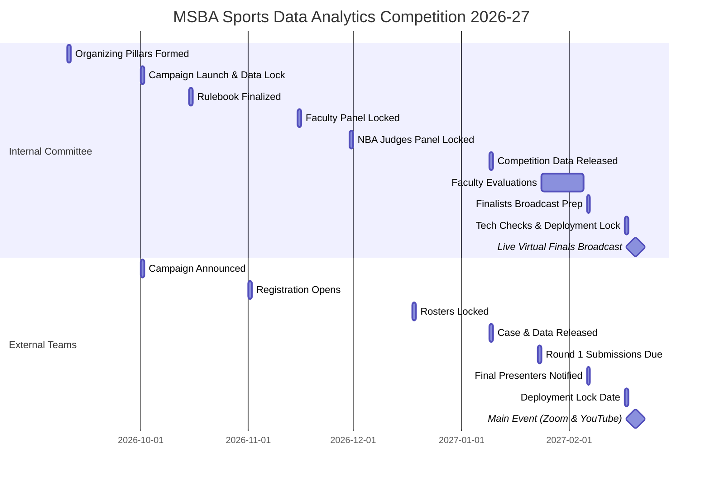

# MSBA Sports Data Analytics Competition 🏀

We have created four premium brand logo variants for the competition. You can compare them below:

| Logo Variant 1: Sideways Drive (With Shield) | Logo Variant 2: Front-Facing Drive (With Shield) |
| :---: | :---: |
|  |  |
| *Jerry West style with background analytics shield.* | *Front-facing drive pose with data charts.* |

| Logo Variant 3: Sideways Drive (Shield-Free - Floating Graphs) | Logo Variant 4: Sideways Drive (Shield-Free - Circular Grid) |
| :---: | :---: |
|  |  |
| *Clean silhouette with floating analytics nodes.* | *Profile silhouette with circular basketball stats wireframe.* |

Welcome to the official administration and planning workspace for the **MSBA Sports Data Analytics Competition** (organized by the USC Marshall School of Business MS in Business Analytics program). This workspace contains the documents, guidelines, timelines, and assets needed to plan, execute, and participate in this elite virtual competition.

---

## 📂 Directory Map & File Structure
You can navigate the documentation using the clickable links below:

* **[README.md](file:///Users/milanmiric/Documents/Admin%20Work%20Documents/MSBA%20-%20Baseketball%20Case%20Competition/README.md):** Workspace index, sitemap, and master timeline visual.

### 🌐 Public Documents (Candidate-Facing)
* **[one_page_summary_flyer.pdf](file:///Users/milanmiric/Documents/Admin%20Work%20Documents/MSBA%20-%20Baseketball%20Case%20Competition/public_documents/one_page_summary_flyer.pdf):** Official one-page flyer in ready-to-distribute PDF format.
* **[one_page_summary_flyer.html](file:///Users/milanmiric/Documents/Admin%20Work%20Documents/MSBA%20-%20Baseketball%20Case%20Competition/public_documents/one_page_summary_flyer.html):** Print-ready, styled HTML executive flyer with USC Cardinal & Gold branding.
* **[one_page_summary_flyer.md](file:///Users/milanmiric/Documents/Admin%20Work%20Documents/MSBA%20-%20Baseketball%20Case%20Competition/public_documents/one_page_summary_flyer.md):** High-impact one-page executive summary flyer with Jerry West emblem, deadlines, prompt details, and requirements.
* **[spirit_and_timeline.md](file:///Users/milanmiric/Documents/Admin%20Work%20Documents/MSBA%20-%20Baseketball%20Case%20Competition/public_documents/spirit_and_timeline.md):** 2027 Competition overview, virtual broadcast details, external timelines, and applicant due dates.
* **[competition_rulebook.md](file:///Users/milanmiric/Documents/Admin%20Work%20Documents/MSBA%20-%20Baseketball%20Case%20Competition/public_documents/competition_rulebook.md):** Participant eligibility rules, team structure caps, live dashboard deliverables, AI policy, and GitHub repository reproducibility specifications.
* **[case_prompt.md](file:///Users/milanmiric/Documents/Admin%20Work%20Documents/MSBA%20-%20Baseketball%20Case%20Competition/public_documents/case_prompt.md):** The official competition analytics task: "In-Game Strategy & Real-Time Decision-Making for Coaches and Basketball Executives" (live interactive dashboard/graphic with situational filtering, evaluation rubrics, and AI policy).
* **[archive/case_prompt_archived_2026.md](file:///Users/milanmiric/Documents/Admin%20Work%20Documents/MSBA%20-%20Baseketball%20Case%20Competition/public_documents/archive/case_prompt_archived_2026.md):** Archived v1 prompt ("When are Star Basketball Players Most Effective?").

### 🔒 Internal Documents (Committee-Only)
* **[committee_structure_and_timeline.md](file:///Users/milanmiric/Documents/Admin%20Work%20Documents/MSBA%20-%20Baseketball%20Case%20Competition/internal_documents/committee_structure_and_timeline.md):** Committee timeline responsibilities, evaluation rubrics, anonymization checklists, and roster roles for the Executive Committee.
* **[data_scoping_and_pipeline.md](file:///Users/milanmiric/Documents/Admin%20Work%20Documents/MSBA%20-%20Baseketball%20Case%20Competition/internal_documents/data_scoping_and_pipeline.md):** Data acquisition partnerships (NBA play-by-play data) and pipeline security locking timelines.
* **[operations_and_logistics.md](file:///Users/milanmiric/Documents/Admin%20Work%20Documents/MSBA%20-%20Baseketball%20Case%20Competition/internal_documents/operations_and_logistics.md):** Operations handbook containing virtual platform setup (Zoom Webinar & YouTube streaming), AV controls, judge binder digital distribution, and zero-budget framework.
* **[outreach_and_communications.md](file:///Users/milanmiric/Documents/Admin%20Work%20Documents/MSBA%20-%20Baseketball%20Case%20Competition/internal_documents/outreach_and_communications.md):** Target academic programs marketing lists, school invitation templates, and judge recruitment outreach scripts.

### 🎓 MSBA Program Documents (Sara McLachlan / Admin-Only)
* **[MSBA_Program_Requirements_and_Alignment.md](file:///Users/milanmiric/Documents/Admin%20Work%20Documents/MSBA%20-%20Baseketball%20Case%20Competition/MSBA/MSBA_Program_Requirements_and_Alignment.md):** Academic learning outcomes, core coursework integration, internal USC candidate screening process, and student volunteer framework.
* **[Event_Budget_and_Catering_Plan.md](file:///Users/milanmiric/Documents/Admin%20Work%20Documents/MSBA%20-%20Baseketball%20Case%20Competition/MSBA/Event_Budget_and_Catering_Plan.md):** Zero-budget operational breakdown, cloud infrastructure leverage, and virtual coordination model.
* **[Presenter_Gifts_and_Liaison_Plan.md](file:///Users/milanmiric/Documents/Admin%20Work%20Documents/MSBA%20-%20Baseketball%20Case%20Competition/MSBA/Presenter_Gifts_and_Liaison_Plan.md):** Virtual hospitality guidelines for NBA executive judges, digital certificates of distinction, and digital awards distribution.

---

## 📅 Roadmap & Candidate Due Dates

The vertical roadmap below highlights candidate-facing phases, milestones, and active deadlines (marked with **🚨 DUE**).

```text
📌 ROADMAP & DEADLINE TRACKING
========================================================================

  [ Oct 1, 2026 ] ──────────► 📣 Case Competition Advertisement Campaign
                              └─ Announcements & save-the-dates sent to target schools
                                   │
                                   ▼
  [ Nov 1, 2026 ] ──────────► 🚀 Registration Portal Opens
                              └─ Official school invitations distributed
                                   │
                                   ▼
  [ Dec 18, 2026 ] ─────────► 🚨 Roster Registration Deadline (DUE)
                              └─ Roster lock (4-5 students, max 2 teams/school)
                                   │
                                   ▼
  [ Jan 9, 2027 ] ──────────► 📊 Case Release & Datasets Launched
                              └─ Virtual "Tip-Off Event" livestream
                                   │
                                   ▼
  [ Jan 23, 2027 ] ─────────► 🚨 Round 1 Submissions Due (DUE)
                              └─ Live Demo URL & GitHub repo link
                                   │
                                   ▼
  [ Feb 6, 2027 ] ──────────► 📢 Final Presenters Notified
                              └─ Top 3 to 5 teams invited to live broadcast finals
                                   │
                                   ▼
  [ Feb 17, 2027 ] ─────────► 🚨 Final Tool & Code Lock (DUE)
                              └─ Finalist live tools locked; technical stream checks
                                   │
                                   ▼
  [ Feb 20, 2027 ] ─────────► 🏆 The Main Event (Zoom & YouTube Broadcast)
                              └─ Live tool demonstrations & Q&A (9:00 AM – 11:00 AM EST)
========================================================================
```

---

## 📅 Chronological Dual Timeline

### Comparison Timeline View
This table displays the concurrent timelines between the internal organizing pillars and the external team milestones leading up to the main event.

| Date | Internal Committee & Data Timeline | External Competitor Milestones | Status |
| :--- | :--- | :--- | :--- |
| **Sep 10, 2026** | Form Core Organizing Pillars (Analytics, Outreach, Operations) | *Pre-registration phase* | Completed |
| **Oct 1, 2026** | **Data Asset Lock** & Zero-Budget Model Validation | **Advertisement & Campaign Launch** | Launched |
| **Oct 15, 2026** | Rulebook and landing page asset locked | *Pre-registration phase* | Completed |
| **Nov 1, 2026** | Launch registration portal | **Registration Portal Opens** / School invitations sent | Active |
| **Nov 15, 2026** | Preliminary Faculty Judging Panel locked | Team recruitment & formation | Planned |
| **Nov 30, 2026** | NBA Finals Judging Panel locked (3–5 professionals) | Team recruitment & formation | Planned |
| **Dec 18, 2026** | *Roster audits and validation* | **Registration Deadline / Roster Lock** | 🚨 **DUE** |
| **Jan 9, 2027** | **Data Released Externally** & Virtual Tip-Off webinar | **Case Prompt & Data Launch** | Released |
| **Jan 23, 2027** | *Submission portals prepared* | **Round 1 Submissions Due** (Live Demo & GitHub) | 🚨 **DUE** |
| **Jan 24 – Feb 5, 2027**| **Faculty Evaluation Window** | *Preliminary review* | In Review |
| **Feb 6, 2027** | Coordinate broadcast logistics with finalists | **Final Presenters Notified** (Top 3-5 teams) | Announced |
| **Feb 17, 2027** | Finalist deployment lock, AV Zoom/YouTube streaming checks | Tool walkthrough rehearsal & dry-run | In Progress |
| **Feb 20, 2027** | **Event Broadcast Execution (Zoom & YouTube)** | **The Main Event (9:00 AM – 11:00 AM EST)** | **EVENT DAY** |

---

### Visual Timeline (Gantt Chart)

